```{r}
#| label: setup
#| include: false
library(ggplot2)
```

Clase para el curso *Conservación del Suelo y Gestión del Carbono* (REN237-1), Pontificia Universidad Católica de Chile.

## Introducción

::: numero-grande
100.000
:::

En un solo metro cuadrado de suelo puede haber hasta 100.000 ácaros [@fao2020] y, en la mayoría de los ecosistemas terrestres, entre 10.000 y 100.000 colémbolos [@fao2020]. Y si contamos a todos los organismos, un metro cuadrado de suelo rico puede albergar hasta mil millones [@britannica_soilorg]. ¿Qué hace que estas cifras suban o bajen?

El recorrido tiene cinco partes:

1.  ¿Qué hay en el suelo?
2.  ¿Qué hacen sus organismos?
3.  ¿Cómo sabemos si el suelo está sano?
4.  El suelo en el Antropoceno
5.  Actividad: detectives del suelo

## 1. ¿Qué hay en el suelo?

> "La importancia de los infinitamente pequeños es infinitamente grande".\
> - Louis Pasteur (1822–1895)

![Composición aproximada de un suelo [@aee2026].](../img/composicion_suelo.jpg){fig-alt="Gráfico circular de la composición del suelo: 45 % minerales, 25 % agua, 25 % aire y 5 % materia orgánica" width="55%" fig-align="center"}

Alrededor del 5 % del volumen de un suelo es materia orgánica, viva y muerta:

- **Viva (biota del suelo):** raíces de las plantas; microorganismos como bacterias, hongos y algas; y fauna (micro, meso y macrofauna).
- **Muerta:** restos frescos como hojas, raíces y animales muertos (hojarasca); materia orgánica particulada, es decir, fragmentos en descomposición; y humus y materia orgánica unida a los minerales, la fracción más estable.

La fauna y los microbios convierten la hojarasca en materia orgánica del suelo y la mezclan con la parte mineral [@chenu2015; @baretta2011].

### Los organismos del suelo

```{mermaid}
%%| fig-cap: "Clasificación clásica de los organismos del suelo [@baretta2011]."
flowchart TD
  O(Organismos del suelo) --> F("Animales (fauna)")
  O --> V("Vegetales (flora)")
  F --> MA(Macrofauna)
  F --> ME(Mesofauna)
  F --> MI(Microfauna)
  V --> MF(Macroflora)
  V --> MIF(Microbiota)
  classDef default fill:#EFE3CF,stroke:none,color:#4A3A2A,rx:12,ry:12
  linkStyle default stroke:#A8875F,stroke-width:2px
```

La clasificación más usada es la de @swift1979: por tamaño, pero también por movilidad, hábito alimentario y función. Los límites cambian según el autor; @lavelle1994, por ejemplo, extienden la mesofauna hasta 4 mm.

::: {.galeria .g2 .cuadrada .contener}
![Clasificación de la fauna del suelo por ancho del cuerpo [@nielsen2019].](../img/tamanos_nielsen.png){fig-alt="Gráfico de la fauna del suelo ordenada por el ancho del cuerpo"}

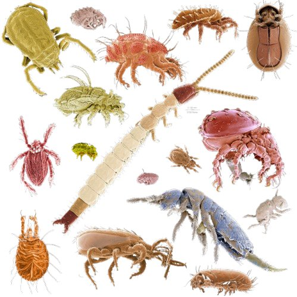{fig-alt="Collage de ácaros, colémbolos y otros pequeños artrópodos"}
:::

### Ácaros (*Acari*)

- Parientes de arañas y escorpiones; cuerpo sin regiones visibles;
- Los adultos tienen 4 pares de patas; la larva, solo 3;
- Tienen la dieta más variada del grupo: hongos, materia en descomposición y otros animales;
- Hay unas 50.000 especies descritas, pero podrían ser más de un millón;
- Los oribátidos llegan a 100.000 individuos por m² en algunos bosques.

::: {.galeria .g3 .cuadrada}
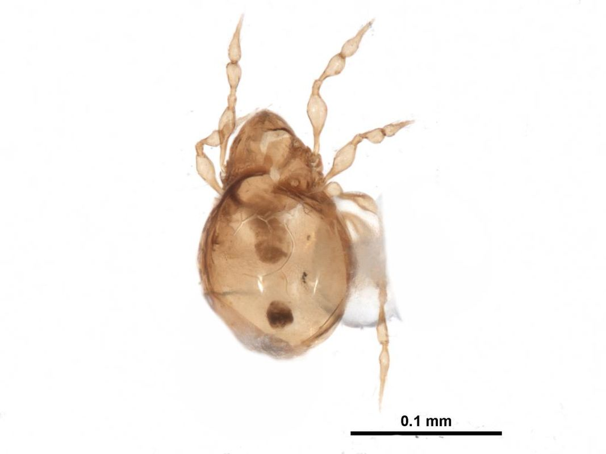{fig-alt="Ácaro pequeño y claro" width="446"}

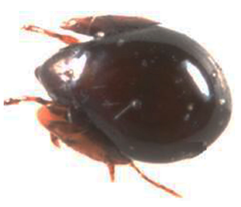{fig-alt="Ácaro oscuro y redondeado" width="417"}

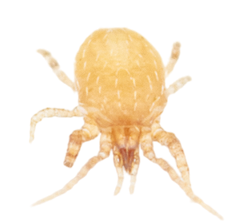{fig-alt="Ácaro claro de patas largas"}
:::

### Colémbolos (*Collembola*)

- **Fúrcula:** una "cola" que funciona como catapulta para escapar de los depredadores;
- **Colóforo:** tubo ventral que los fija al sustrato (del griego *colla*, pegamento);
- Comen hongos y materia orgánica muerta, y estimulan a los microbios descomponedores;
- Mudan durante toda la vida, y muchos se reproducen sin machos;
- Son muy sensibles a la humedad y a la temperatura.

::: {.galeria .g3 .cuadrada}
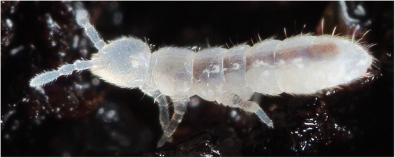{fig-alt="Colémbolo blanco y alargado"}

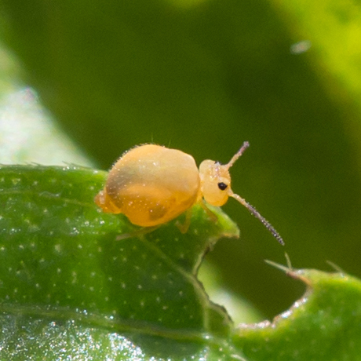{fig-alt="Colémbolo globoso amarillo sobre una hoja"}

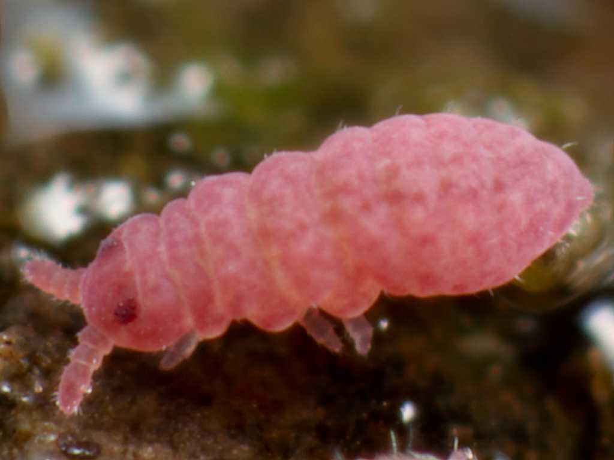{fig-alt="Colémbolo rosado"}
:::

Fuentes: @baretta2011; @toma2017.

El salto de los colémbolos, en cámara lenta (New Scientist), basado en el estudio de @ortega2022:



### El resto de la mesofauna

::: {.galeria .g5 .cuadrada}
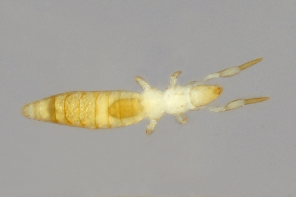{fig-alt="Proturo"}

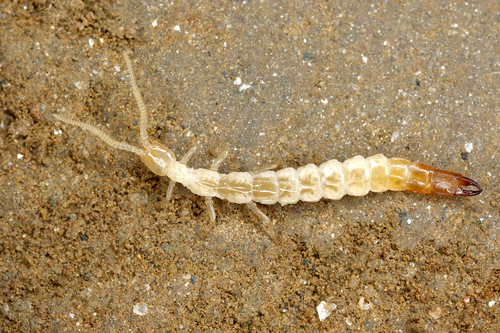{fig-alt="Dipluro"}

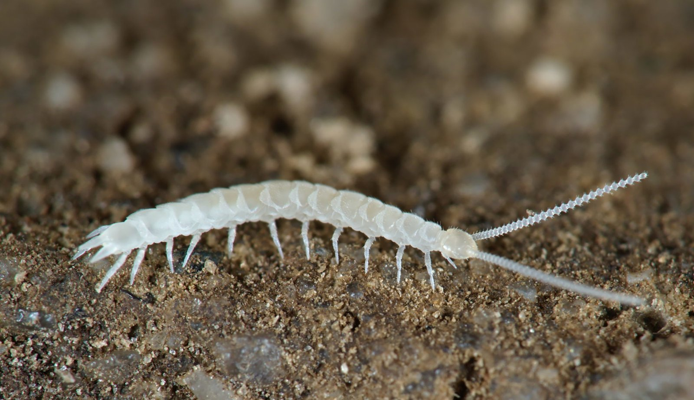{fig-alt="Sínfilo"}

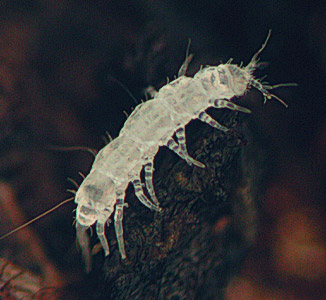{fig-alt="Paurópodo"}

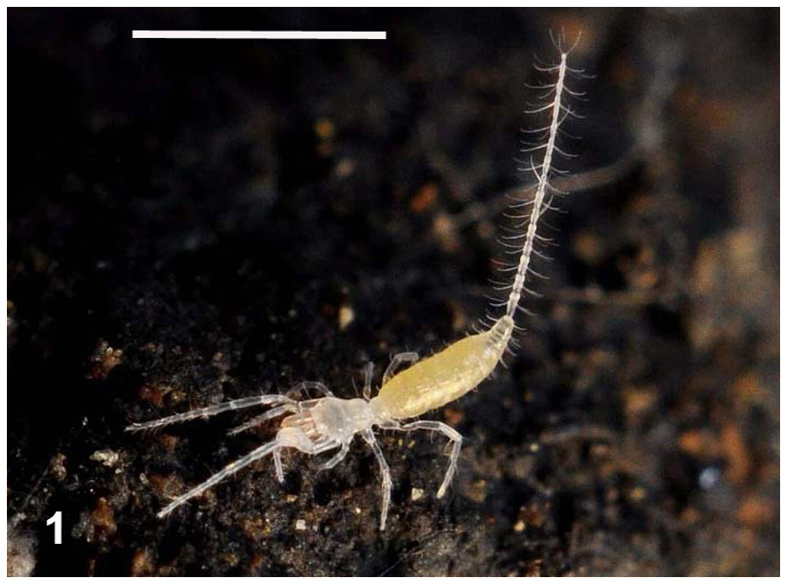{fig-alt="Palpígrado"}
:::

Los enquitreidos, o "lombrices blancas", también forman parte de la mesofauna. Dependen de humedad, pH neutro o levemente ácido y suelo no compactado, y pueden llegar a 146.000 individuos por m^2^ en bosques templados [@toma2017].

### Algunas curiosidades

- Una cucharadita de suelo contiene más organismos vivos que personas en el mundo [@fao2020, p. 12].
- Un gramo de suelo puede contener hasta mil millones de células de bacterias, de decenas de miles de taxones, y hasta 200 metros de hifas de hongos [@fao2020, p. 12].
- El suelo alberga más del 25 % de la biodiversidad del planeta [@fao2020, p. 110].
- Aunque puede haber 100.000 ácaros en un metro cuadrado, todos juntos pesan apenas unos 2 g [@fao2020, p. 47].
- La biomasa de toda la fauna del suelo es menos del 4 % de la biomasa microbiana, pero la fauna aumenta la descomposición de la hojarasca en un 27 % en promedio [@fao2020, p. 48].

## 2. ¿Qué hacen sus organismos?

### Grupos según lo que comen

| Grupo | Qué comen | Ejemplos |
|------------------------|------------------------|------------------------|
| Detritívoros | Restos vegetales en descomposición | diplópodos, isópodos |
| Saprófagos | Residuos vegetales en varios estados de descomposición |  |
| Coprófagos | Excrementos de otros animales | escarabajos, lombrices |
| Fungívoros y microbívoros | Hifas, esporas, bacterias | colémbolos, muchos ácaros |
| Fitófagos | Raíces y tejidos vivos | sínfilos, algunos nematodos |
| Depredadores | Otros animales vivos | ácaros gamásidos, arañas |

: Grupos tróficos de la fauna del suelo [@baretta2011; @toma2017].

La fauna del suelo forma una red trófica completa, y por eso una misma práctica de manejo puede favorecer a un grupo y perjudicar a otro.

### Microbios y fauna no actúan de la misma manera!

Las actividades de la fauna y de los microorganismos están muy relacionadas, pero cada grupo trabaja de forma distinta [@baretta2011]:

- **Microorganismos:** acción química. Hacen la mayor parte de la descomposición de una hoja y la transformación de las sustancias húmicas;
- **Fauna:** acción química y física. Reduce el tamaño de los residuos, mezcla partículas, forma poros y estabiliza agregados;
- **Respiración:** todos los organismos aeróbicos liberan CO^2^, pero la mayor parte del CO^2^ del suelo proviene de las raíces y de los microbios. El humus se forma sobre todo por acción microbiana [@lepsch2011];
- **Lombrices:** tragan grandes cantidades de suelo; sus enzimas y excrementos contribuyen a formar humus y mejoran la estructura y la aireación [@lepsch2011].

### Las funciones de la fauna

::: {.galeria .g3}
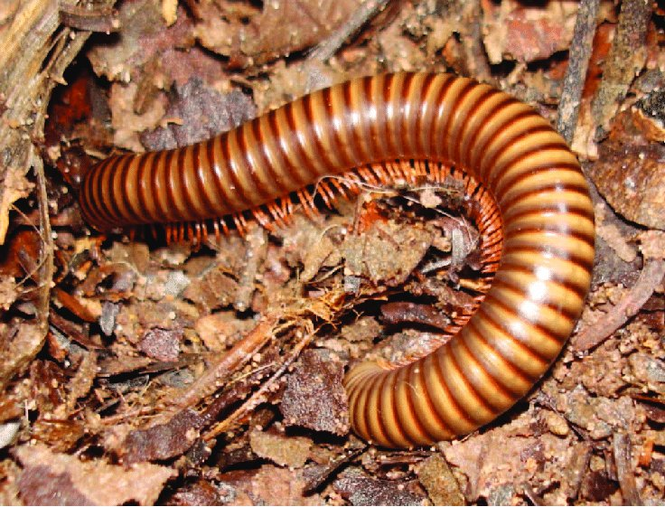{fig-alt="Diplópodo"}

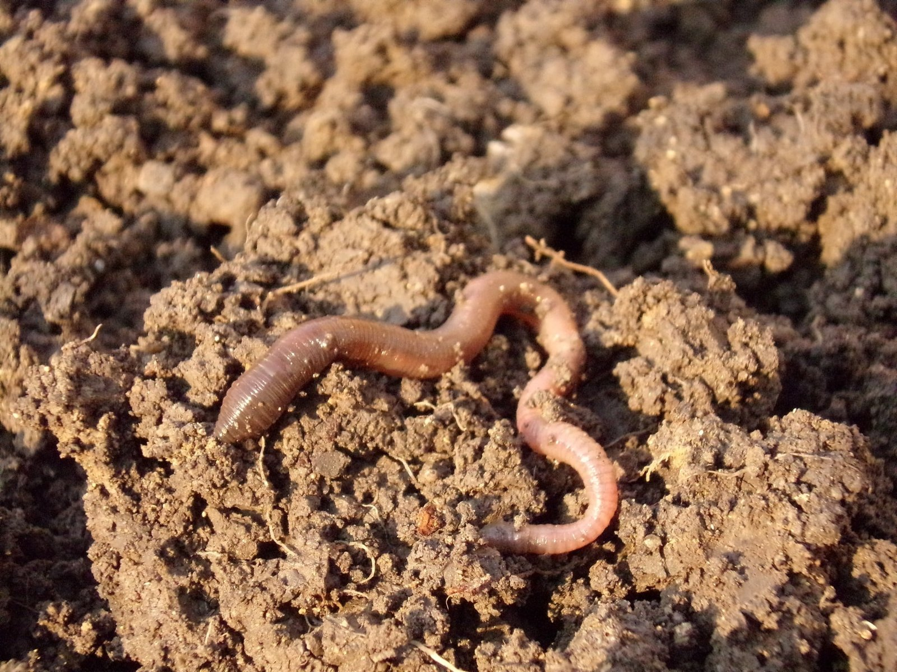{fig-alt="Lombriz"}

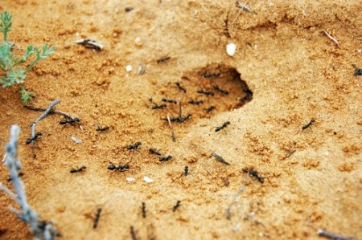{fig-alt="Entrada de un hormiguero"}

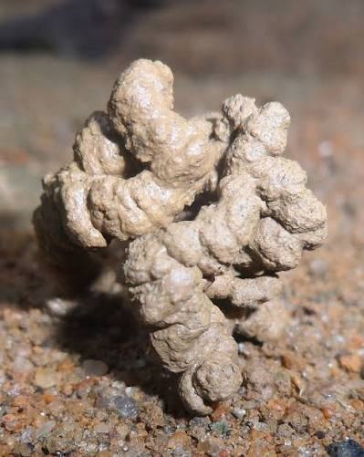{fig-alt="Excrementos de lombriz"}

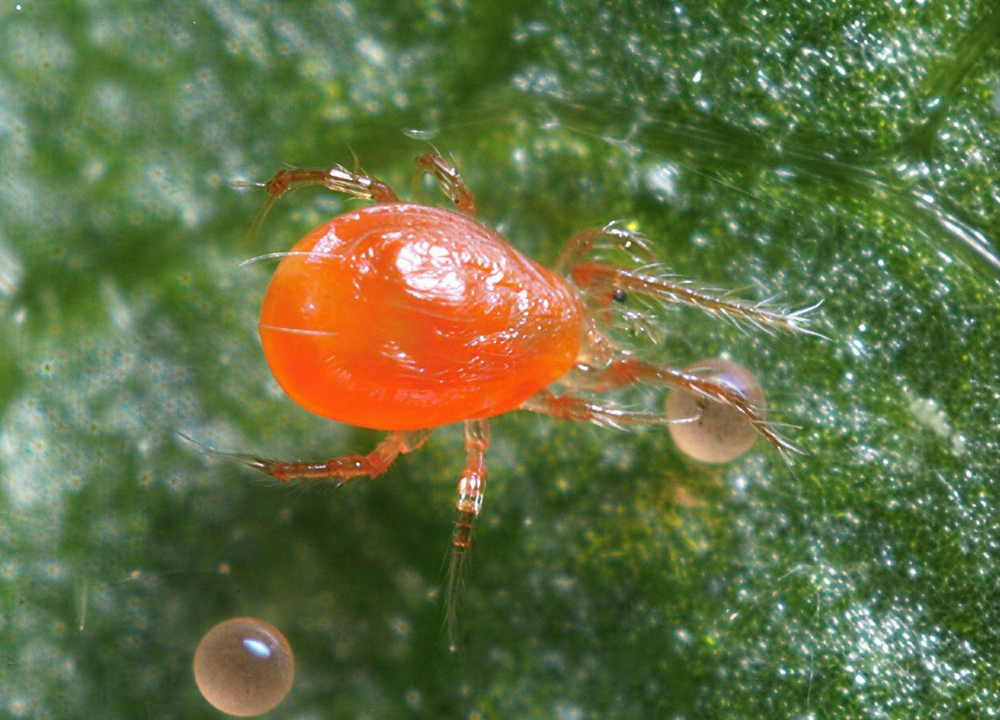{fig-alt="Ácaro depredador rojo"}

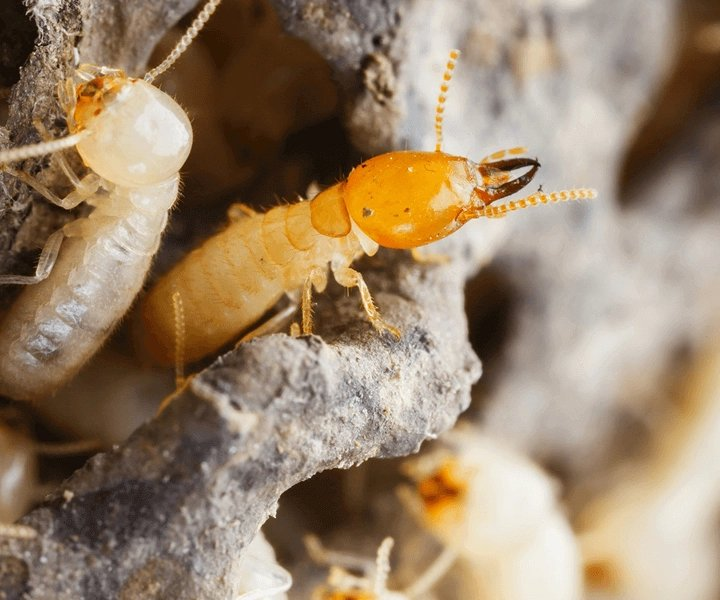{fig-alt="Termitas"}
:::

Fuente: @baretta2011.\
Las galerías y poros los construye sobre todo la macrofauna (lombrices, termitas, hormigas); la mesofauna actúa más en la fragmentación, en la regulación de hongos y bacterias y en la dispersión de esporas.

### El otro lado de la moneda

Cuando se habla de microorganismos, lo primero que se asocia son las enfermedades. Esa percepción tiene una base histórica, porque los primeros microorganismos estudiados estaban relacionados con enfermedades humanas [@dionisio_kusdra, p. 14]. En el suelo también viven organismos que causan problemas, y la biota del suelo puede provocar pérdidas importantes en los cultivos [@fao2020, p. 134]. Algunos ejemplos:

- *Spongospora subterranea*, un protista del suelo que causa lesiones en los tubérculos y agallas en las raíces de la papa, y cuyas esporas persisten en el suelo por muchos años [@fao2020, p. 41];
- nematodos que parasitan raíces y sínfilos que dañan raíces de cultivos;
- *Bacillus anthracis*, bacteria nativa del suelo que parasita al ganado y causa el ántrax [@dionisio_kusdra, p. 15].

Sin embargo, los organismos perjudiciales son pocos comparados con los benéficos, que descomponen residuos, reciclan nutrientes y tienen usos agrícolas, industriales y farmacéuticos [@dionisio_kusdra, p. 14]. Además, la propia biota del suelo ayuda a controlar a los patógenos:

- en un suelo sano y sin perturbar, las bacterias no patógenas suelen superar en competencia a las patógenas, y las actinobacterias, como *Streptomyces*, producen antibióticos que inhiben a los patógenos de plantas [@fao2020, p. 14];
- en laboratorio, algunos colémbolos prefieren comer hongos patógenos antes que hongos micorrízicos, y pueden reducir enfermedades de raíz en cereales; en el campo, el efecto depende de su densidad [@fao2020, p. 57];
- las lombrices pueden regular patógenos de plantas y el desarrollo de enfermedades [@fao2020, p. 63].

El suelo también nos protege a nosotros. De él se aislaron los primeros microorganismos productores de antibióticos: la penicilina, de hongos; la neomicina, de bacterias; y la estreptomicina, de actinobacterias [Moreira y Siqueira, 2006, citado en @dionisio_kusdra, p. 15]. Y mucho antes de la industria farmacéutica ya había contacto con ellos: se encontró tetraciclina en esqueletos de la antigua Nubia, en Sudán, de los años 350 a 550 d. C. [Nelson et al., 2010, citado en @fao2020, p. 142].

### Distribución

![Mapa mundial de biodiversidad potencial del suelo [@fao2020].](../img/mapa_fao.jpg){fig-alt="Mapa mundial de la biodiversidad potencial del suelo"}

El número de organismos del suelo varía según las condiciones ambientales y es mucho mayor en ecosistemas naturales que en suelos agrícolas. Un suelo hoy deforestado y cultivado se formó bajo la influencia de muchos otros organismos, además de los que lo habitan ahora. Esa influencia es mayor en los trópicos húmedos, porque en latitudes templadas el invierno reduce el número de especies [@lepsch2011].

La fauna vive cerca de la superficie: bajo eucalipto, el 97,7 % de los individuos estaba en los primeros 10 cm del suelo [Soares y Costa, 2001, citado en @baretta2011]. La temperatura regula su metabolismo y, junto con la humedad, decide dónde viven y cuándo están activos. También dependen de la materia orgánica, la porosidad, la cobertura vegetal, el pH, la textura y el manejo [@lavelle_spain2001; @dionisio_signor]. Por eso cualquier práctica que afecte la superficie, como arar, quemar, dejar el suelo desnudo o cubrirlo con rastrojo, cambia rápidamente la fauna.

**Curiosidad**: algunos microorganismos viven en condiciones extremas, como *Deinococcus radiodurans*, muy resistente a la radiación, y *Desulforudis audaxviator*, que vive a aproximadamente 3,2 km de profundidad!

::: {.galeria .g2}
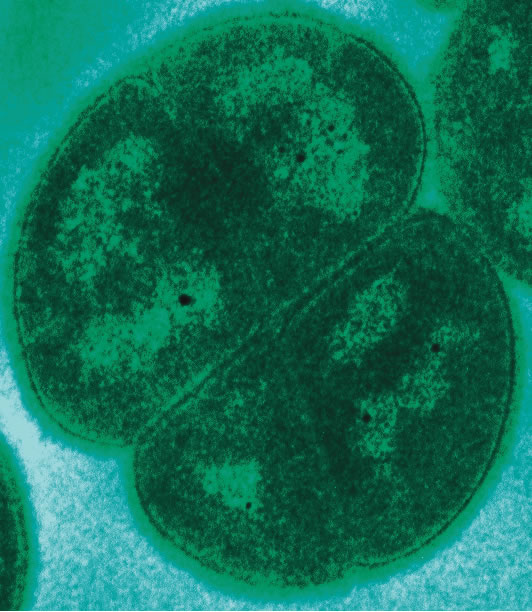{fig-alt="Células de Deinococcus radiodurans"}

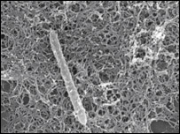{fig-alt="Bacteria alargada al microscopio electrónico"}
:::

## 3. ¿Cómo sabemos si el suelo está sano?

### ¿Que es la salud del suelo?

- Es la capacidad de un suelo de funcionar, en un momento dado, como un sistema vivo vital [@doran2000].
- Un suelo sano está en buen estado químico, físico y biológico [@ue2025].
- Un suelo sano está bien agregado, de modo que el aire y el agua puedan penetrarlo, y limpio, sin sustancias tóxicas [@primavesi2016].
- La salud de un suelo se mide comparándolo con lo que ese tipo de suelo podría ser [@clesse2026]:

$$\text{Salud del suelo} = \text{estado funcional actual} - \text{estado funcional de referencia}$$

Un valor positivo indica un suelo más sano que su referencia; cero = similar; y negativo = menos sano.

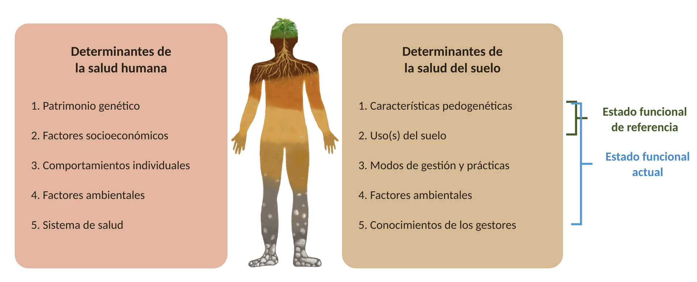{fig-alt="Comparación entre los determinantes de la salud humana y los determinantes de la salud del suelo"}

### Lo que vacía el suelo de vida

::: {.galeria .g3}
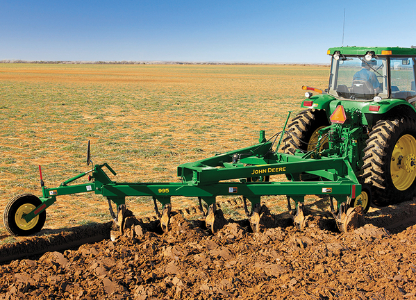{fig-alt="Tractor arando"}

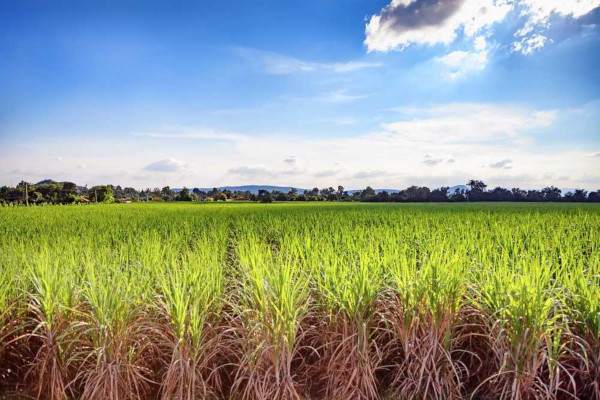{fig-alt="Monocultivo"}

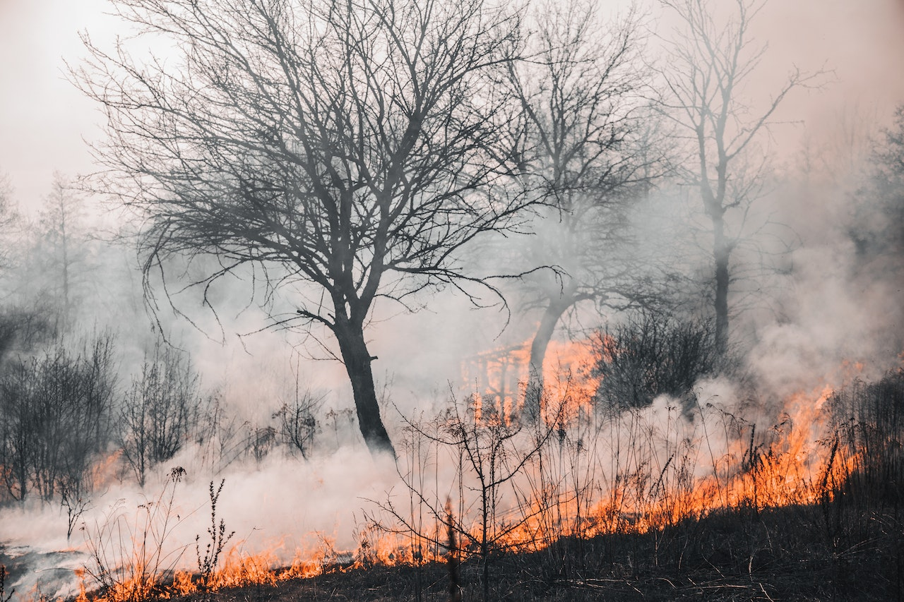{fig-alt="Quema"}

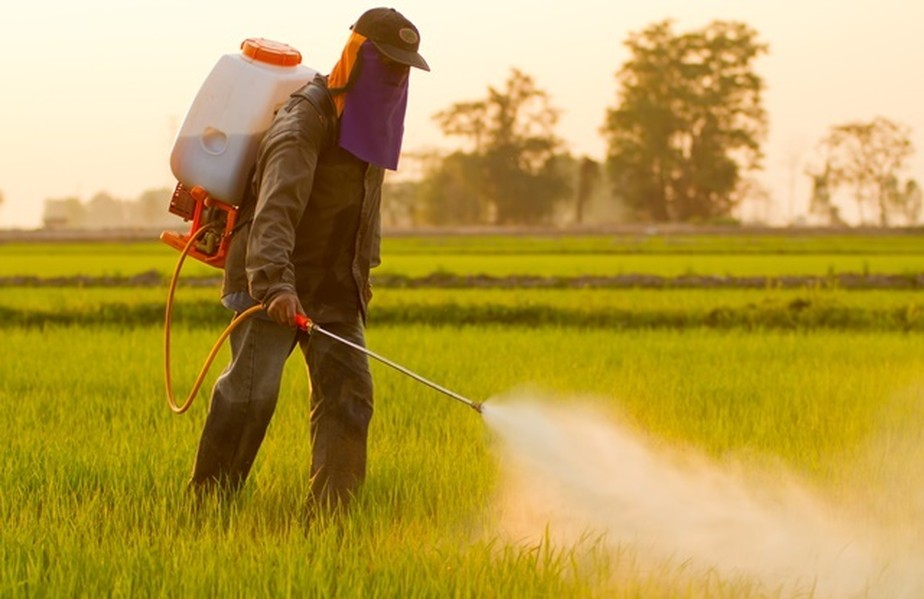{fig-alt="Aplicación de plaguicida"}

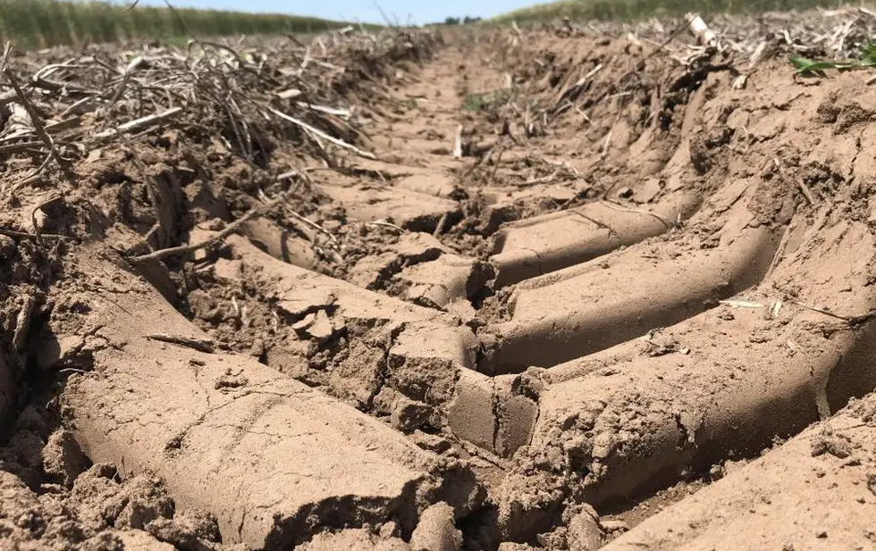{fig-alt="Huellas de maquinaria"}

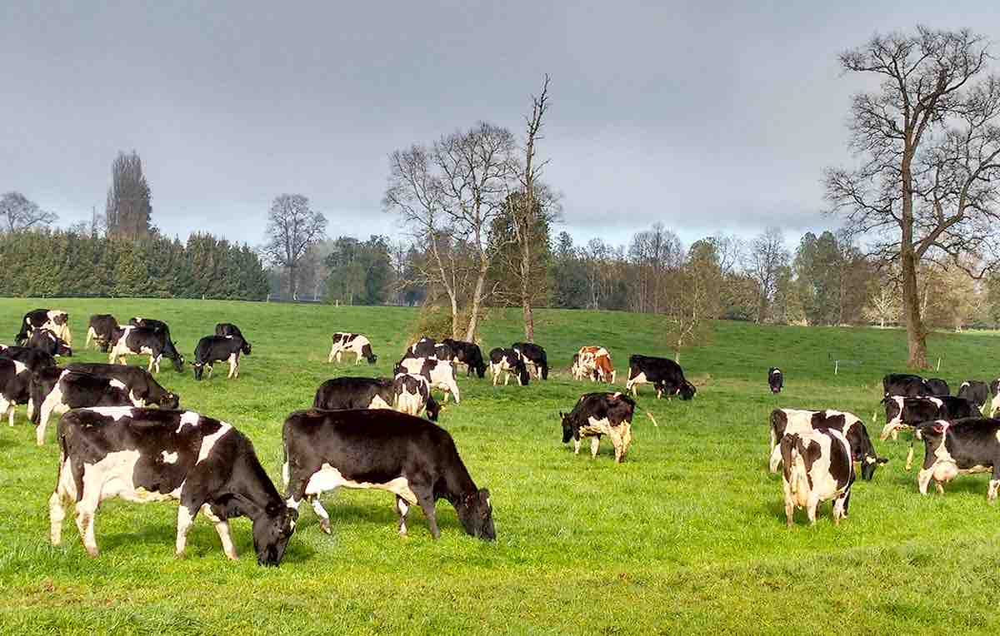{fig-alt="Vacas en una pradera"}
:::

### ¿Y qué es lo que devuelve la vida al suelo?

::: {.galeria .g3}
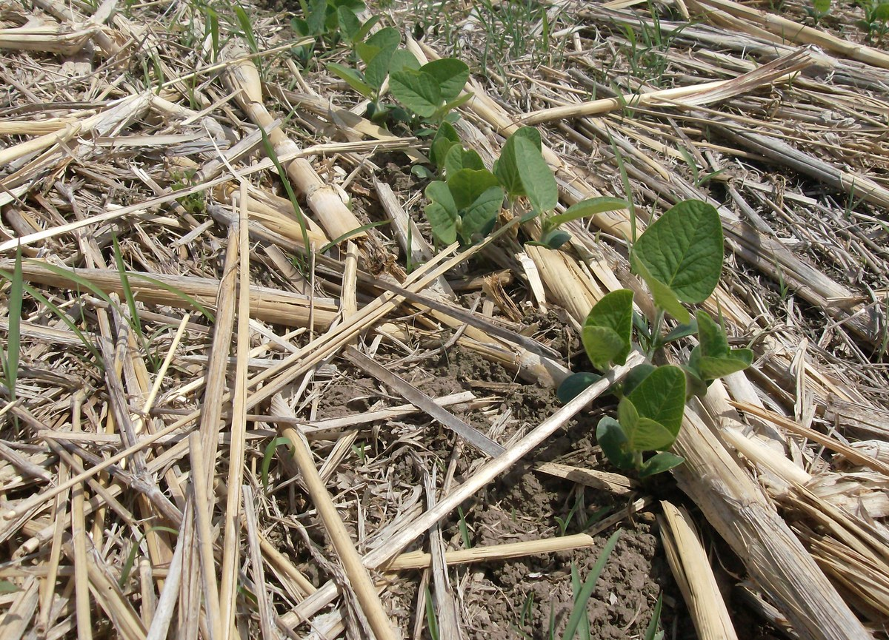{fig-alt="Plántulas entre rastrojo"}

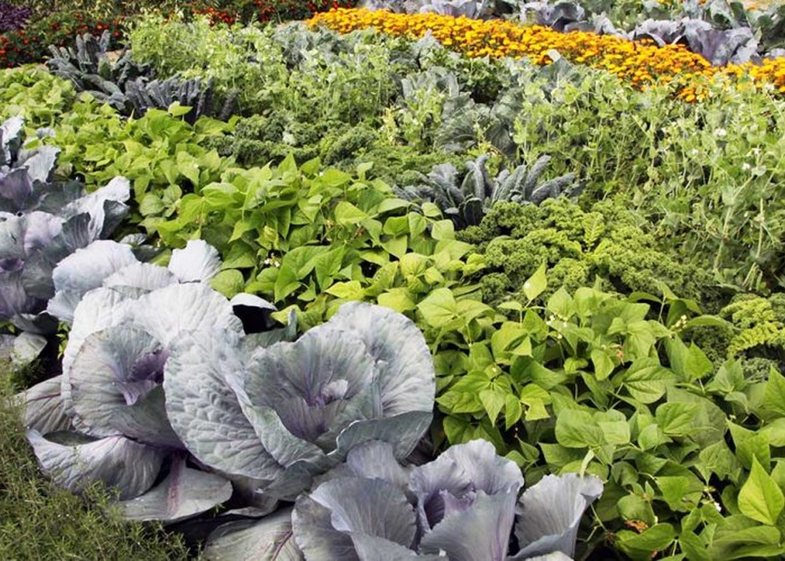{fig-alt="Cultivos asociados"}

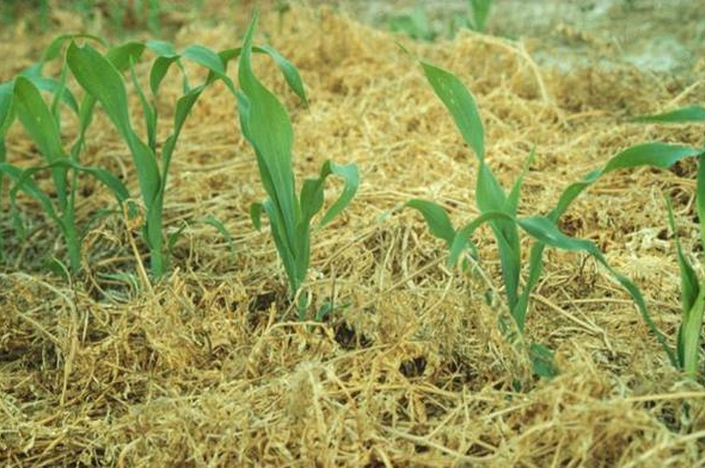{fig-alt="Maíz con cobertura de paja"}

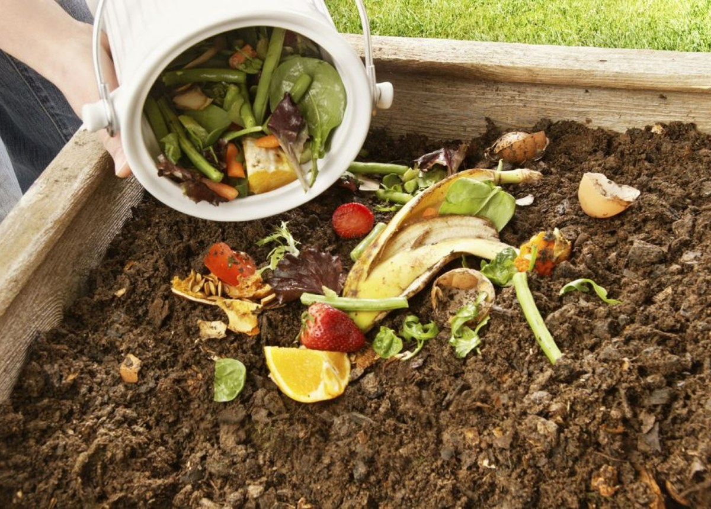{fig-alt="Compostera"}

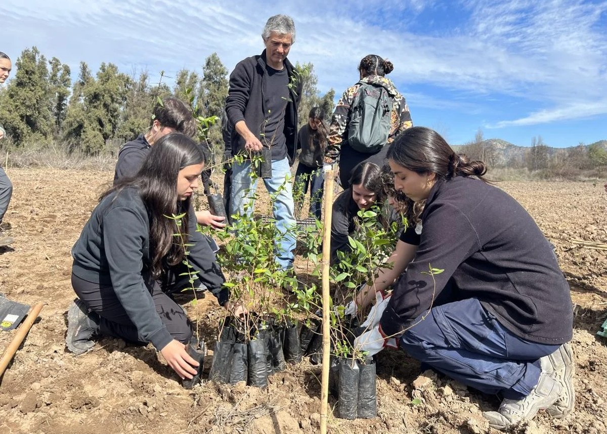{fig-alt="Plantación de árboles"}

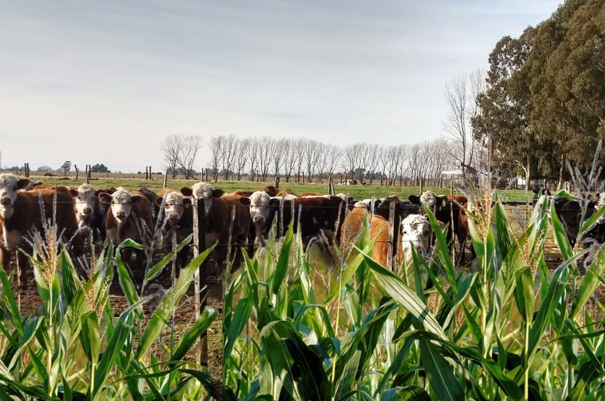{fig-alt="Ganado junto a un cultivo"}
:::

Fuente: @baretta2011, que reúne los trabajos de Nunes et al. (2009), Minor et al. (2004) y Dias et al. (2007), entre otros.

Las prácticas que reducen la fauna afectan alguna de tres cosas que necesita: (i) alimento (materia orgánica); (ii) refugio (poros, hojarasca, cobertura) o (iii) condiciones estables (temperatura y humedad).\
Las prácticas de recuperación devuelven esas mismas tres cosas. Aun así, más individuos no siempre indican un suelo mejor, pues, algunos ácaros aumentan con fertilizantes nitrogenados o insecticidas porque desaparecen sus depredadores, por ejemplo [@baretta2011].

### La recuperación recorre la degradación al revés

```{mermaid}
%%| fig-cap: "Siqueira et al. (2008) y Topp et al. (2001), en @baretta2011."
flowchart LR
  A("<b>Lo físico</b><br/>frenar la erosión,<br/>descompactar y<br/>cubrir el suelo") --> B("<b>Lo químico</b><br/>corregir pH y nutrientes,<br/>retirar o fijar<br/>contaminantes")
  B --> C("<b>Lo biológico</b><br/>vuelve la fauna y,<br/>con ella, las funciones")
  C -. "mejora" .-> A
  classDef default fill:#EFE3CF,stroke:none,color:#4A3A2A,rx:12,ry:12
  linkStyle default stroke:#A8875F,stroke-width:2px
```

La recuperación puede tardar de pocos años a varias décadas. Una vez que la fauna vuelve, mejora a su vez las propiedades físicas y químicas del suelo. Los colémbolos suelen ser de los primeros en volver. Sin embargo, una población muy grande de pocas especies también puede ser señal de perturbación.

### Los organismos del suelo como bioindicadores

Los bioindicadores son especies, grupos de especies o comunidades cuya presencia o ausencia, abundancia y condición revelan una determinada condición ambiental [@baretta2011, p. 138]. Como los organismos del suelo son sensibles a cualquier cambio físico, químico o biológico, sirven para evaluar la calidad del suelo y el efecto del manejo. Su uso crece en todo el mundo porque son fáciles de muestrear y representan bien el ambiente [@baretta2011, p. 138].

Con ellos se puede evaluar la alteración o destrucción del hábitat, la contaminación por metales pesados o agroquímicos, la rehabilitación de áreas degradadas, la sucesión de la vegetación y el tipo de manejo adoptado [@baretta2011, p. 139]. Algunos ejemplos:

- **Ácaros oribátidos:** tienen desarrollo lento, ciclos de vida de hasta varios años y baja fecundidad, por lo que son muy sensibles a la perturbación del suelo. En viñedos europeos, su abundancia fue el indicador más sensible de la degradación por erosión entre todos los grupos estudiados [Costantini et al., 2018, citado en @fao2020, p. 48].
- **Lombrices, colémbolos y nematodos:** son los bioindicadores de la fauna del suelo más establecidos [@fao2020, p. 108].
- **Lombrices y termitas:** se usan como indicadores de menor o mayor sensibilidad a las acciones humanas [Turco y Blume, 1999, citado en @baretta2011, p. 139].
- **Ensayos de laboratorio:** organismos como el colémbolo *Folsomia candida* [@oecd232] y el ácaro *Oppia nitens* [@iso23266] se usan en ensayos estandarizados para evaluar la toxicidad de un suelo, como en mi maestría.

## 4. El suelo en el Antropoceno

::::: columns
::: {.column width="55%"}
El término **Antropoceno** fue propuesto por Paul Crutzen y Eugene Stoermer [@crutzen2000] para describir un tiempo en el que la especie humana deja de ser un animal como los demás y pasa a modificar el planeta a escala geológica. Su oficialización en la escala del tiempo geológico generó un gran debate, y en marzo de 2024 la IUGS ratificó el rechazo de la propuesta [@iugs2024]. Eso no significa que el Antropoceno no exista, sino que no es una unidad formal de la escala geológica.

En los suelos, esta discusión aparece en categorías como los Technosoles, los Antropossolos y los SUITMAs. Si @jenny1941 puso a los organismos como factor formador del suelo, en el Antropoceno el ser humano se convierte en un factor dominante.
:::

::: {.column width="45%"}
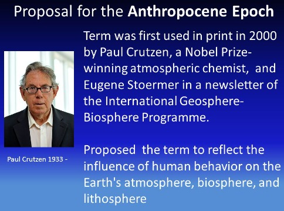{fig-alt="Paul Crutzen"}
:::
:::::

### Un poco de mi maestría: Ácaros en suelos del Antropoceno

::::: columns
::: {.column width="55%"}
En mi maestría estudié dos perfiles de suelo, P1 y P2, en cultivos de batata dulce (*Ipomoea batatas*) con labranza convencional en el APA do Timburi, Presidente Prudente (São Paulo, Brasil), antes y después del cultivo. Ambos fueron clasificados como *Antropossolos Decapíticos Parciálicos*, es decir, suelos sin horizonte A y con capas mezcladas [@curcio2004]. Como referencia se usó un bosque residual presente en el APA.

El análisis de metales por ICP-OES mostró As, Cd y Pb bajo el límite de detección, y Cr y Cu dentro de los valores de intervención de @cetesb2021. Para la norma, estos suelos no están contaminados. La pregunta era si eso los hace seguros para la fauna.
:::

::: {.column width="45%"}
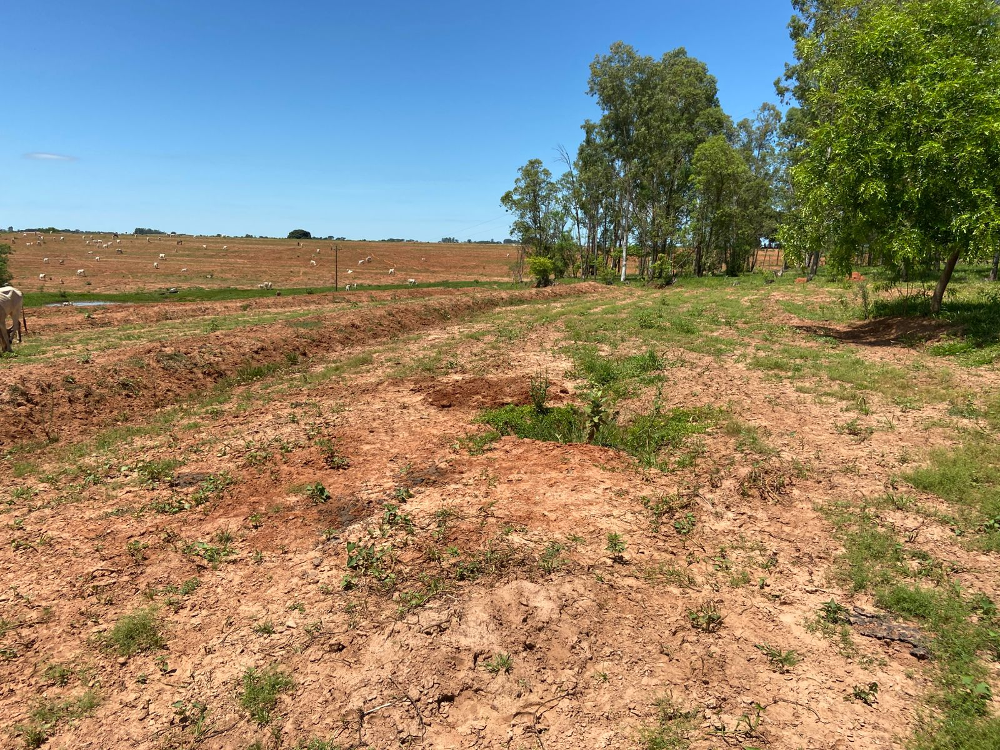{fig-alt="Campo de suelo rojizo con árboles"}
:::
:::::

El P1 tenía poca materia orgánica (7 a 18 g/dm^3^) y quedó ácido tras la cosecha (pH 4,5-4,9). El P2 probablemente recibió encalado y abono, con materia orgánica de hasta 38 g/dm^3^ y pH cercano a 6 [@moreno2026].

### El ensayo con *Oppia nitens*

Los ensayos se hicieron en UC Davis en 2025 con el ácaro oribátido *Oppia nitens*, organismo estándar en ecotoxicología [@iso23266]. Se agregó cadmio (Cd) a las muestras de suelo enviadas desde Brasil y se midieron el crecimiento (14 días), la sobrevivencia y la reproducción (28 días).

El crecimiento se mide por el color del tegumento, que se oscurece a medida que el ácaro crece [@jegede2023]. En cada réplica se pusieron 5 ácaros adultos en 3 g de suelo con 0, 200 o 400 mg/kg de Cd, y se fotografiaron bajo el estereomicroscopio en los días 0, 3, 6, 9 y 14. El color se convierte en valores RGB, CMYK y luminosidad, y la caída (o aumento) de esos valores se usa como medida de crecimiento. En el ensayo de reproducción se pusieron 15 adultos por frasco, con 100 a 1.200 mg/kg de Cd durante 28 días; luego se extrajeron con un [extractor MacFadyen](https://www.ecotech.de/en/product/macfadyen_extractor_1) durante 48 horas y se contaron adultos vivos y juveniles [@oecd232; @iso23266]. La CL50 y la CE50 se calcularon con modelos log-logísticos.

![*Oppia nitens* en los días 0, 3, 6, 9 y 14, en el control y con 200 y 400 mg/kg de cadmio, en suelo de bosque [@moreno2026].](../img/oppia_color.jpg){width="70%" fig-align="center" fig-alt="Ácaros que se oscurecen con el tiempo en el control y no en los tratamientos con cadmio"}

::: {.galeria .g2 .contener}
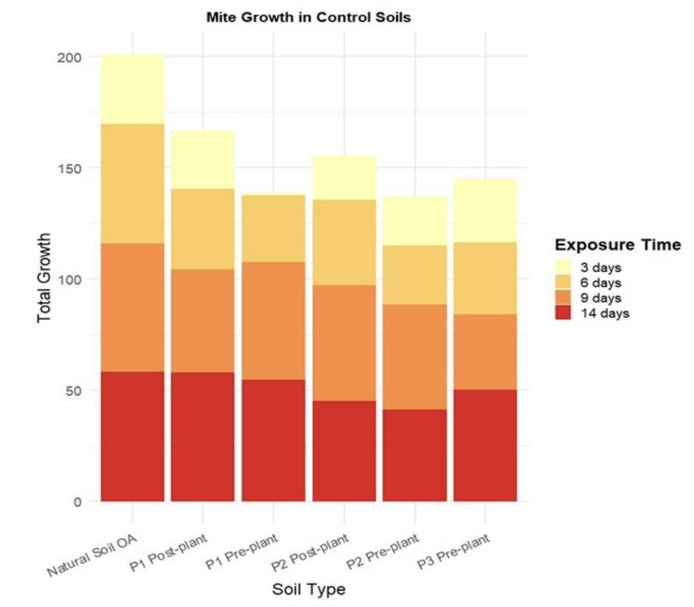{fig-alt="Barras de crecimiento en suelos sin cadmio"}

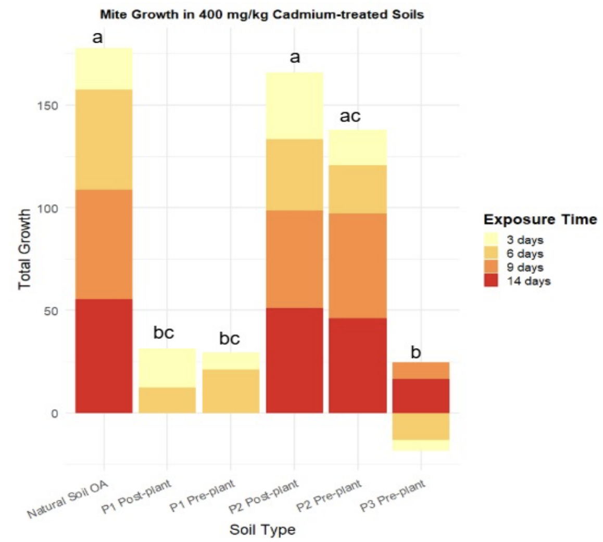{fig-alt="Barras de crecimiento en suelos con cadmio"}
:::

::: {.galeria .g4 .vertical}
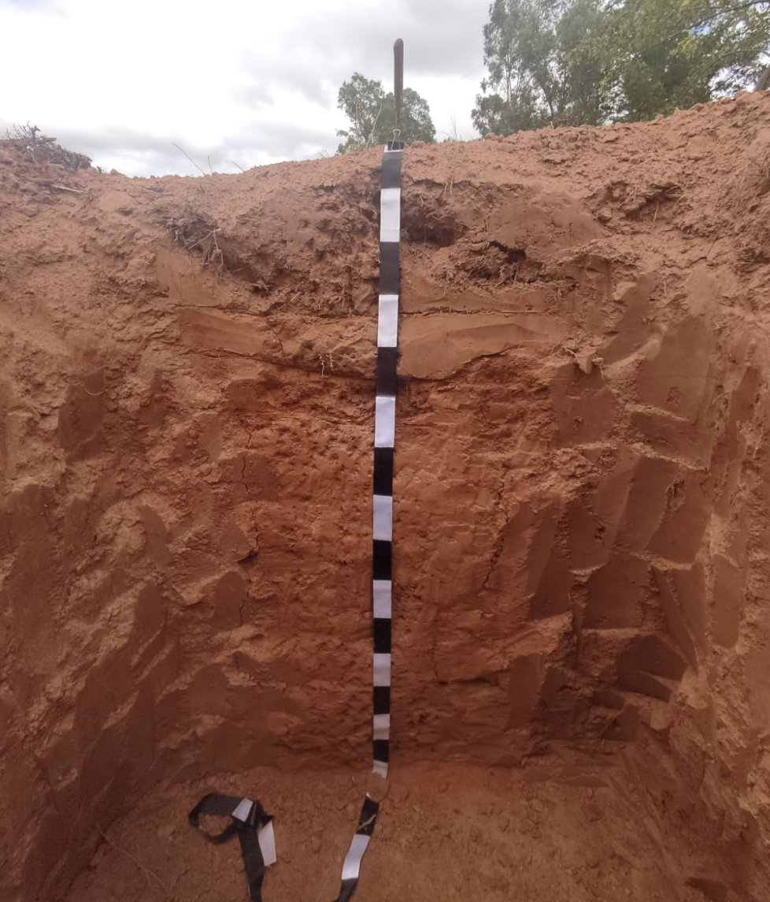{fig-alt="Perfil P1"}

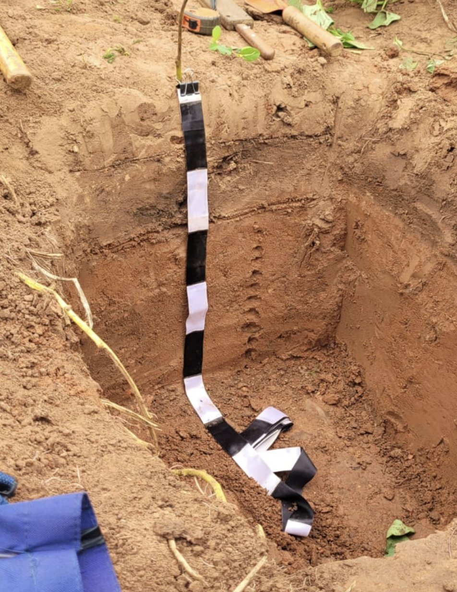{fig-alt="Perfil P2"}

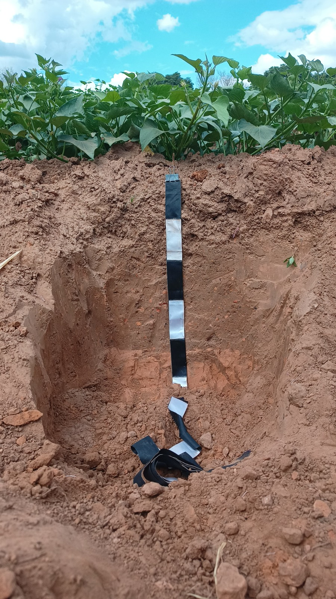{fig-alt="Perfil P3"}

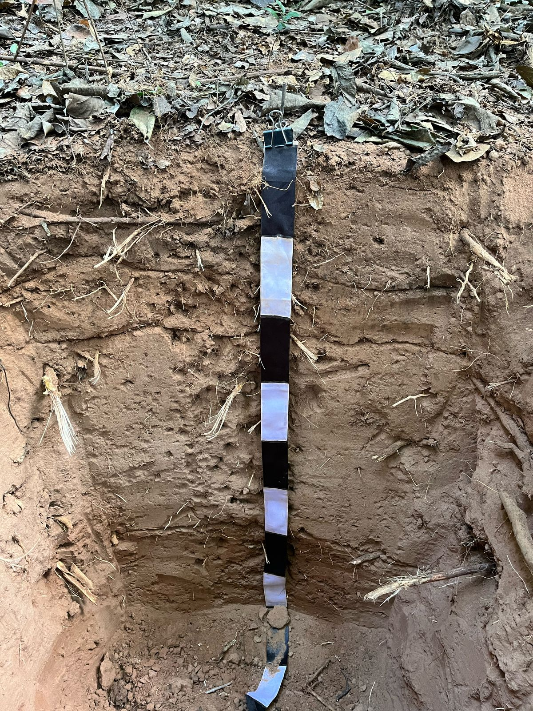{fig-alt="Perfil NS"}
:::

### Misma clase de suelo, suelos diferentes

::: {.galeria .g2 .contener}
![Sobrevivencia tras 28 días; eje x: Cd nominal (mg/kg de suelo) [@moreno2026].](../img/sobrevivencia.png){fig-alt="Curvas de sobrevivencia"}

![Reproducción tras 28 días de exposición a Cd en P1 y P2 post-plantación [@moreno2026].](../img/reproduccion.png){fig-alt="Curvas dosis-respuesta de reproducción"}
:::

```{r}
#| label: fig-toxicidad
#| fig-cap: "Concentración de Cd que mata al 50 % de los ácaros (CL50) o reduce a la mitad su reproducción (CE50). Valores más altos indican un suelo que protege más a la fauna. Datos: Moreno (2026)."
#| fig-alt: "Barras: en P1 la CL50 es 103 y la CE50 es 97 mg/kg; en P2, 664 y 471 mg/kg"
#| fig-width: 7
#| fig-height: 3.8
#| out-width: "85%"
#| fig-align: center
toxicidad <- data.frame(
  suelo  = factor(c("P1", "P2", "P1", "P2"), levels = c("P1", "P2")),
  ensayo = factor(
    c("Sobrevivencia (CL50)", "Sobrevivencia (CL50)",
      "Reproducción (CE50)", "Reproducción (CE50)"),
    levels = c("Sobrevivencia (CL50)", "Reproducción (CE50)")
  ),
  valor  = c(103, 664, 97, 471)
)

ggplot(toxicidad, aes(x = suelo, y = valor, fill = suelo)) +
  geom_col(width = 0.6) +
  geom_text(aes(label = valor), vjust = -0.5, size = 5) +
  facet_wrap(~ ensayo) +
  scale_fill_manual(values = c(P1 = "grey60", P2 = "grey25")) +
  scale_y_continuous(expand = expansion(mult = c(0, 0.12))) +
  labs(x = NULL, y = "mg de Cd por kg de suelo") +
  theme_minimal(base_size = 14) +
  theme(legend.position = "none")
```

El cadmio fue 6 veces más tóxico para la sobrevivencia en P1 (CL50 de 103 contra 664 mg/kg) y 5 veces más tóxico para la reproducción (CE50 de 97 contra 471 mg/kg). Sin cadmio, el crecimiento de los ácaros no difirió del suelo de bosque, es decir, los suelos no eran tóxicos por sí solos.\
Aun dentro de los límites legales, el suelo con menos materia orgánica y más ácido dejó a su fauna más vulnerable. Los resultados muestran una asociación entre las propiedades del suelo y la toxicidad. En el suelo de bosque, la CL50 también varió según la capa, 193 mg/kg en A/E y 581 mg/kg en OA.

## 5. Actividad: detectives del suelo

### El embudo de Berlese-Tullgren

El embudo de Berlese-Tullgren es el método más usado para extraer la mesofauna del suelo. Berlese lo creó en 1905 y Tullgren le agregó la lámpara eléctrica en 1918. Para la macrofauna se usan otros métodos, como monolitos de 25 × 25 cm y 0-20 cm de profundidad con separación manual (método TSBF) y trampas de caída en la interfase suelo-hojarasca.

::::: columns
::: {.column width="58%"}
**Cómo funciona.** La muestra de suelo se coloca sobre una malla, dentro de un embudo, con una lámpara encima. La lámpara calienta y seca la muestra desde arriba, y los animales se desplazan hacia abajo en busca de humedad y oscuridad. Al atravesar la malla, caen en un frasco colector ubicado bajo el embudo.

**El extractor de laboratorio.** Lo ideal sería usar un extractor de alto gradiente tipo MacFadyen, como el que se usó en los ensayos de mi maestría. Este equipo controla la temperatura y la humedad de forma gradual y extrae muchas muestras a la vez, pero es caro.
:::

::: {.column width="42%"}
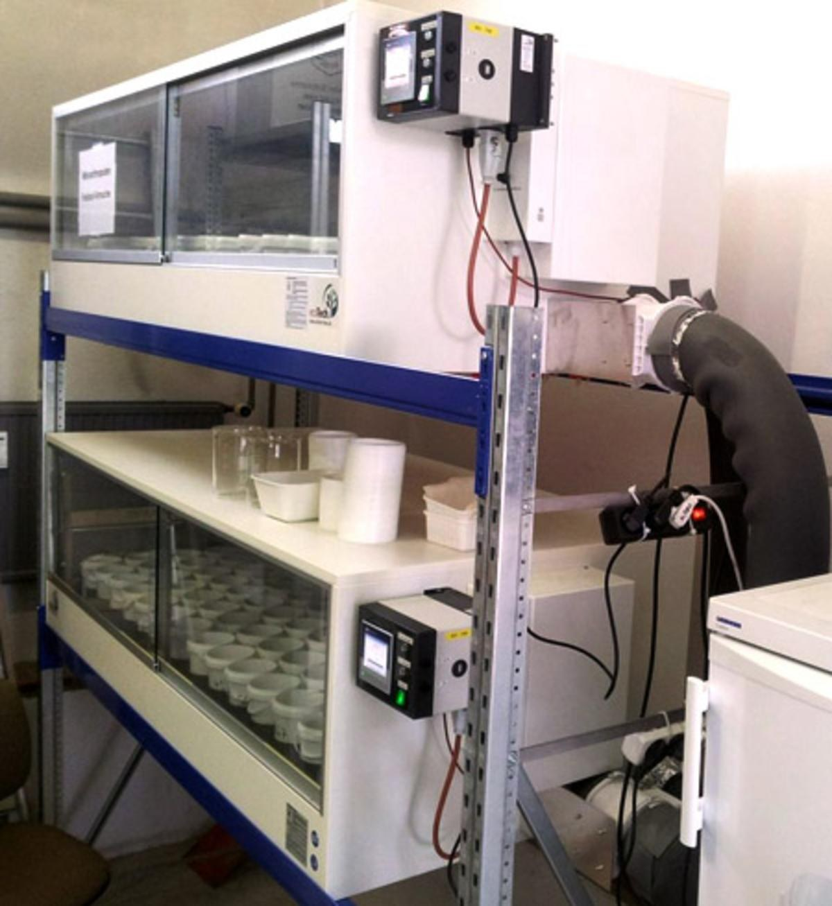{fig-alt="Equipo de laboratorio con dos cámaras de extracción y controladores de temperatura"}
:::
:::::

::::: columns
::: {.column width="58%"}
**La versión casera.** Como alternativa de bajo costo, se puede armar un Berlese-Tullgren casero con estos materiales:

- un embudo de plástico (puede ser hecho con una botella PET, pero encontré este [embudo imprimible en 3D](https://www.printables.com/model/1126967-tullgren-funnel) y, en mi opinión, funciona mejor);
- una malla fina en la salida del embudo (puede ser una de mosquitos, de aproximadamente 2 mm de apertura), para que el suelo no caiga al frasco;
- una lámpara (puede ser de escritorio) con una ampolleta (de 40 watts seria lo ideal) que emita calor;
- un frasco colector de vidrio;
- una muestra de suelo de los primeros 5 cm, con su hojarasca;
- yeso y carbón activado para el sustrato.
:::

::: {.column width="42%"}
![Berlese-Tullgren casero [@toma2017].](../img/berlese_casero.png){fig-alt="Dibujo de un embudo casero con hojarasca bajo una lámpara y un frasco colector con organismos"}
:::
:::::

La muestra se coloca en el embudo sin compactarla, con la lámpara encima, y la extracción puede durar entre 24 y 36 horas. Con alcohol al 70 % en el frasco colector, los organismos quedan conservados para identificarlos después. Para observarlos vivos, el frasco lleva en el fondo una capa de aproximadamente 1 cm de yeso y carbón activado, en proporción 9:1, preparada con agua hasta formar una pasta, secada y humedecida con agua destilada antes de usarla [@oecd232].\
El yeso mantiene la humedad que los organismos necesitan, y el carbón oscurece el fondo, lo que facilita ver a los ácaros y colémbolos claros, además de absorber gases y olores.

La versión que mejor funcionó para esta clase fue la de embudos de plástico impresos sobre frascos de vidrio con base de yeso y carbón:

::: {.galeria .g2 .vertical}
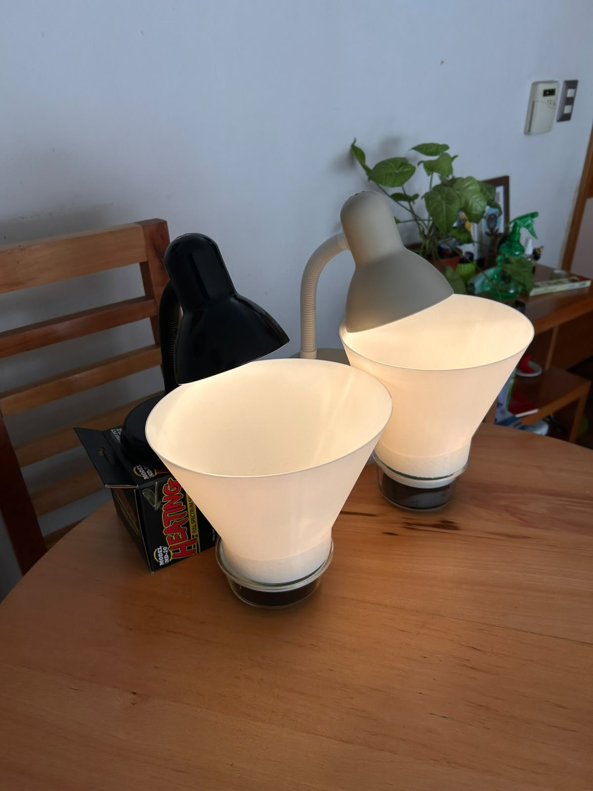{fig-alt="Dos embudos blancos iluminados por lámparas de escritorio sobre frascos de vidrio"}

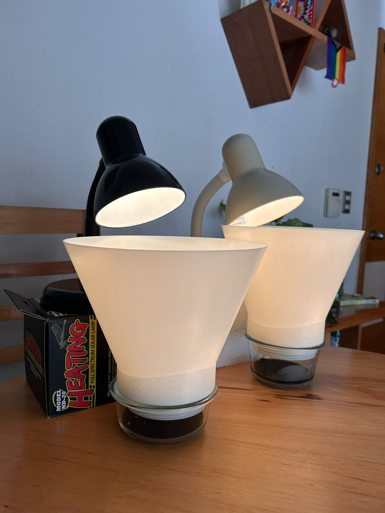{fig-alt="Vista lateral de dos embudos sobre frascos de vidrio con sustrato oscuro"}
:::

Antes hubo otros intentos con botellas plásticas cortadas, usando alcohol en el fondo o una base solo de yeso, con resultados menos satisfactorios. Los organismos del suelo no se mantienen bien en recipientes de plástico blando, lo que puede haber influido.

::: {.galeria .g2 .vertical}
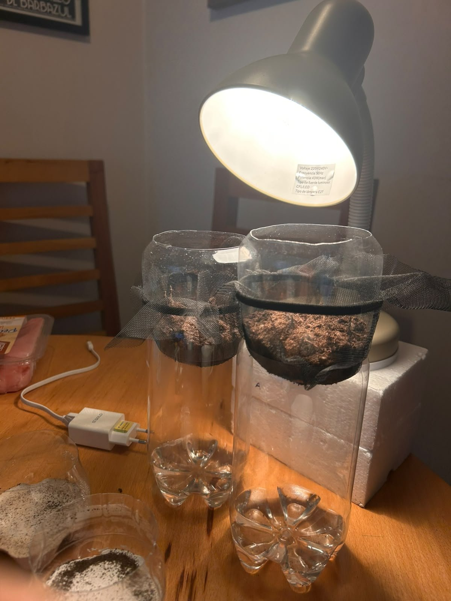{fig-alt="Botellas plásticas cortadas con suelo sobre una malla, bajo una lámpara"}

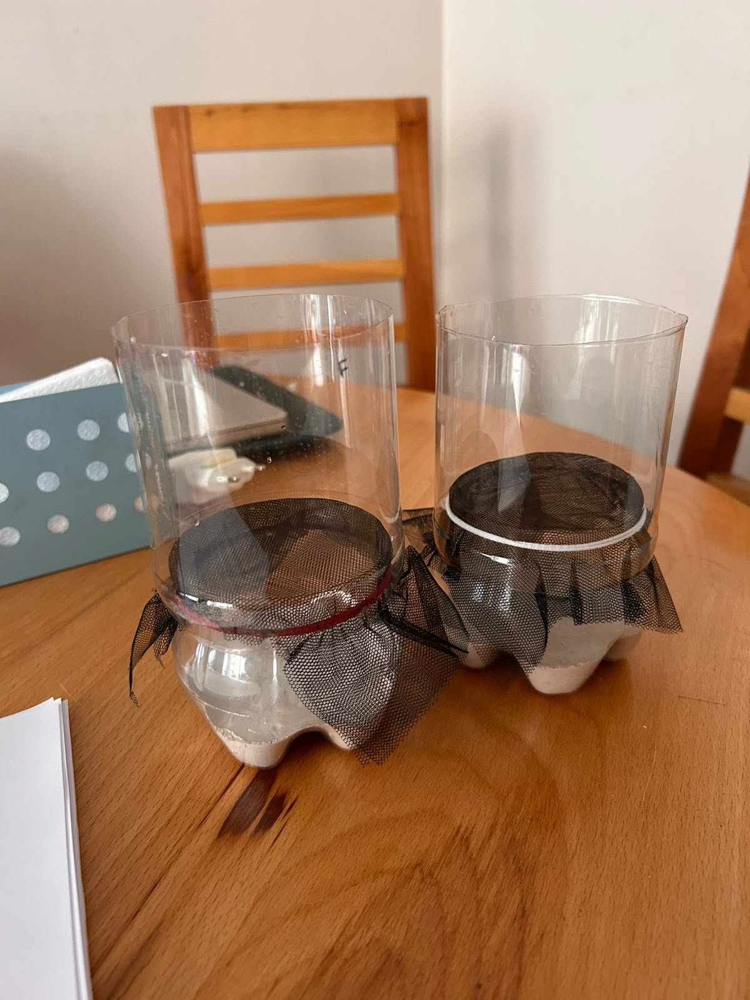{fig-alt="Dos botellas plásticas cortadas con malla negra y base blanca de yeso"}
:::

### La actividad

Para esta clase se colectaron muestras de suelo (30 g, aproximadamente) en dos sitios del campus San Joaquín de la PUC:

- un sitio por donde pasa la gente, sin vegetación encima;
- un sitio bien manejado, con hojarasca.

La fauna de cada muestra se extrajo con un Berlese-Tullgren casero y se mantuvo viva en frascos con base de yeso y carbón.\
En la clase, los frascos se identifican solo como **Suelo A** y **Suelo B**. En grupos, observen ambos frascos en el microscopio y descubran cuál suelo viene de cada sitio.

::: {.galeria .g2 .cuadrada .contener}
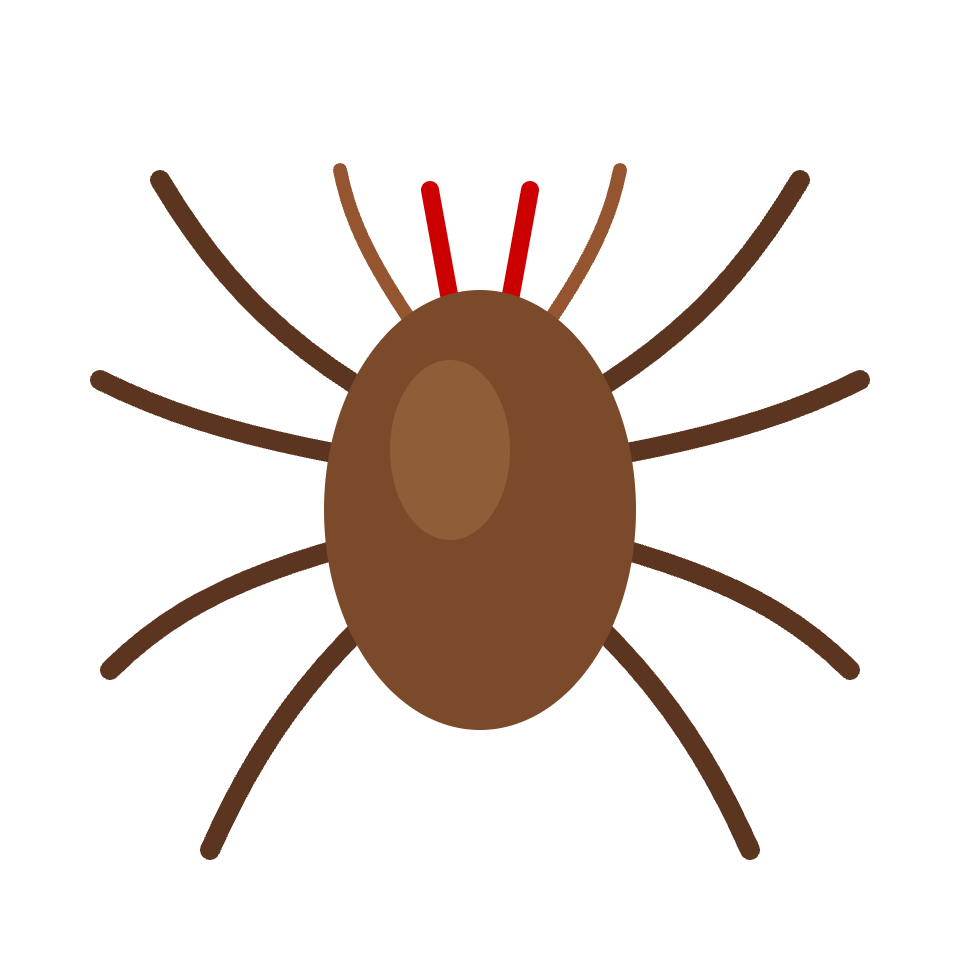{fig-alt="Esquema de un ácaro"}

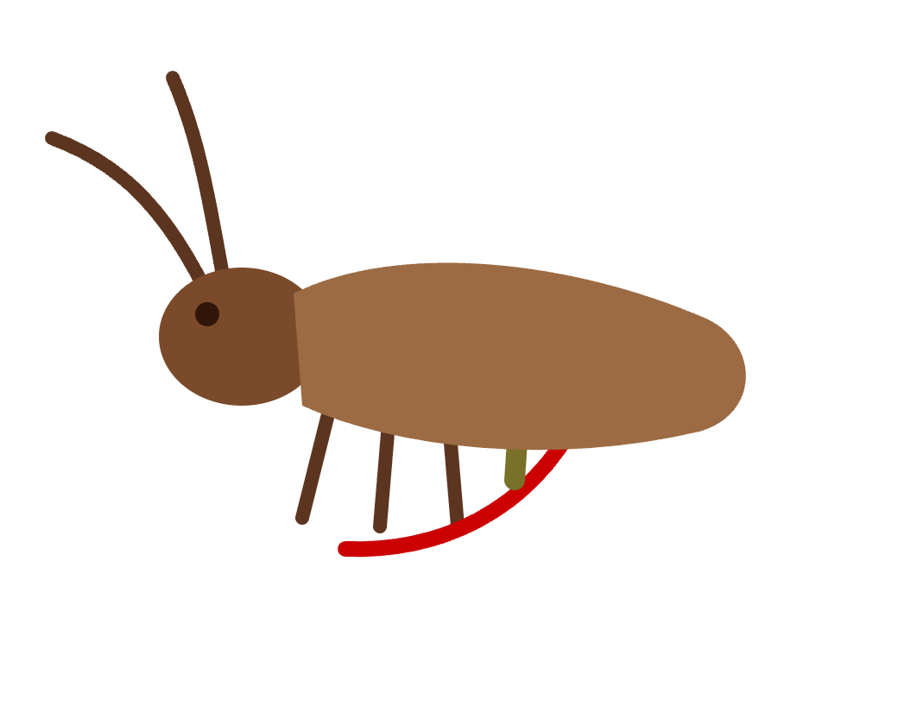{fig-alt="Esquema de un colémbolo"}
:::

Los colémbolos globosos (*Symphypleona*) se confunden fácilmente con ácaros; las antenas y los 3 pares de patas permiten distinguirlos [@toma2017; @baretta2011].

**Preguntas para los grupos:**

1.  ¿En cuál frasco hay más organismos?
2.  ¿Encontraron ácaros, colémbolos u otros organismos? ¿En cuál frasco?
3.  ¿Cuál suelo creen que viene del sitio con hojarasca y cuál del sitio sin vegetación? ¿Por qué?

### La prueba del vaso (opcional)

Esta prueba, inspirada en el *slake test*, compara la estabilidad de los agregados de los dos suelos [@chenu2015]. Se colocan agregados secos de cada suelo en una malla y se sumergen lentamente en agua. Los agregados estables se mantienen enteros; los débiles se desarman en pocos segundos, porque el aire que sale al mojarse los rompe desde dentro.

| Nota | Resultado                               |
|:----:|-----------------------------------------|
|  0   | Se deshace antes de 10 segundos         |
|  1   | Se deshace antes del minuto             |
|  2   | Aguanta 5 minutos y se rompe al sacarlo |
|  3   | Sigue entero después de sacarlo         |

Un agregado estable protege materia orgánica en su interior. La materia orgánica, los excrementos de la fauna y las galerías ayudan a mantenerlo unido.

### ¿Cuál suelo era cuál?

:::: {.callout-note collapse="true" appearance="simple"}
## Ver la respuesta

| Suelo | Sitio                                         |
|:-----:|-----------------------------------------------|
| **A** | Sitio por donde pasa la gente, sin vegetación |
| **B** | Sitio bien manejado, con hojarasca            |

::: {.galeria .g2 .vertical}
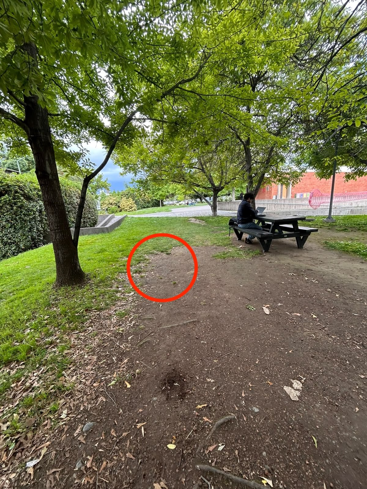{fig-alt="Camino de tierra desnuda bajo árboles, con un círculo rojo en el punto de muestreo"}

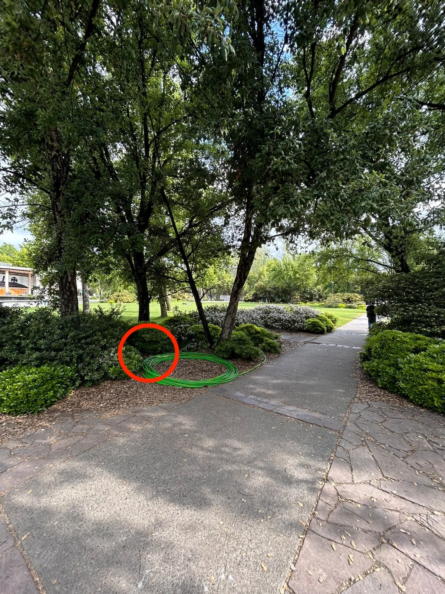{fig-alt="Jardín con arbustos y hojarasca junto a un sendero, con un círculo rojo en el punto de muestreo"}
:::

Ambos sitios están en el campus San Joaquín de la PUC. La diferencia entre ellos es la misma que separa la labranza convencional de la siembra directa: un suelo desnudo y pisoteado frente a uno con cobertura, alimento y refugio para la fauna.
::::

## Para no olvidar!

1.  El suelo está vivo. La fauna y los microbios transforman la materia orgánica muerta y mantienen las funciones del suelo;
2.  La fauna es un buen indicador de salud. Ácaros y colémbolos responden rápido al manejo del suelo;
3.  En el Antropoceno, el ser humano también forma suelos. Podemos degradarlos o ayudar a que recuperen su salud.

Lo que hace que la fauna del suelo aumente o disminuya se resume en tres cosas: (i) alimento, (ii) refugio y (iii) condiciones estables.

## Reproducibilidad {.appendix}

Este documento fue escrito en Quarto con R. Para generarlo se necesitan R, Quarto y los paquetes `ggplot2`, `knitr` y `rmarkdown`, y se renderiza con `quarto render scripts/clase_fauna.qmd`.

## Referencias

::: {#refs}
:::
